<div align="center">


# مصاريفي (Spending Tracker)

**An offline Arabic spending tracker for Android: log a purchase at the till in a few seconds, by tap, voice, photo or barcode.**

[](https://github.com/AbdelRahman-Madboly/spending-tracker/actions/workflows/ci.yml)


-003B57?logo=sqlite&logoColor=white)


**[Download the APK](https://github.com/AbdelRahman-Madboly/spending-tracker/releases/latest/download/spending-tracker-3.1.1-arm64.apk)** · [How it works](#how-it-works) · [Screens](#screens) · [Quick start](#quick-start) · [How data is stored](#how-data-is-stored) · [What it does not do](#what-it-does-not-do)

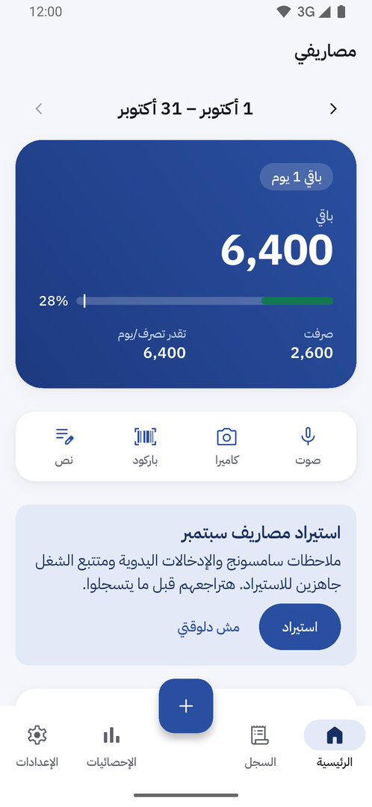 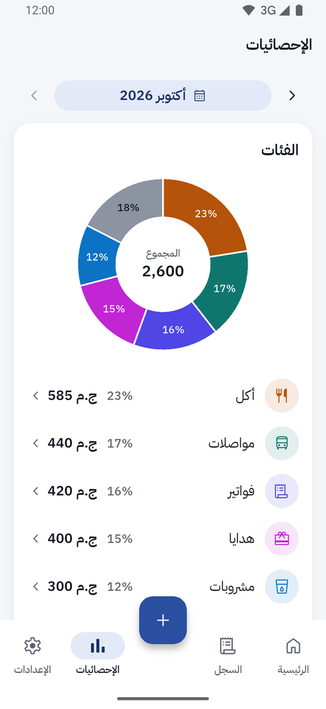 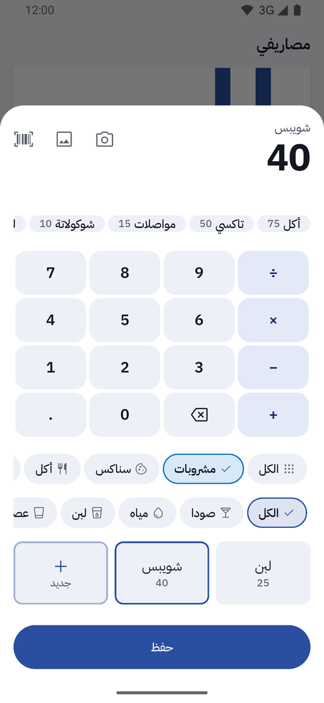

<sub>The <code>personal</code> flavour with its made-up sample data.</sub>

</div>

## Why مصاريفي

A spending log only helps if every purchase makes it in, so logging has to be quick enough to do
at the till. مصاريفي is an Android app for logging personal spending in Egyptian pounds, built in
Flutter, with an Arabic, right-to-left interface. A purchase is meant to be logged at the till in
a few seconds, and everything works offline on one phone with no account.

## Highlights

- **Two taps for a known item.** A known item takes two taps and the digits on the keypad.
- **Four ways to capture.** Voice, photo of a receipt, barcode and text notes all end in one
  review sheet before anything is saved.
- **Salary periods, not calendar months.** The home screen shows what is left of the salary and
  the safe amount per day, plus upcoming bills.
- **Offline and private by default.** No account. Nothing reaches the network unless the master
  online switch and the feature's own switch are both on, and both are off by default.
- **Careful with money.** Amounts are stored as whole piastres, never as a floating point number,
  and the database is copied and checked before every schema migration.
- **Your data stays portable.** Export to .xlsx, and full backup and restore as a zip.

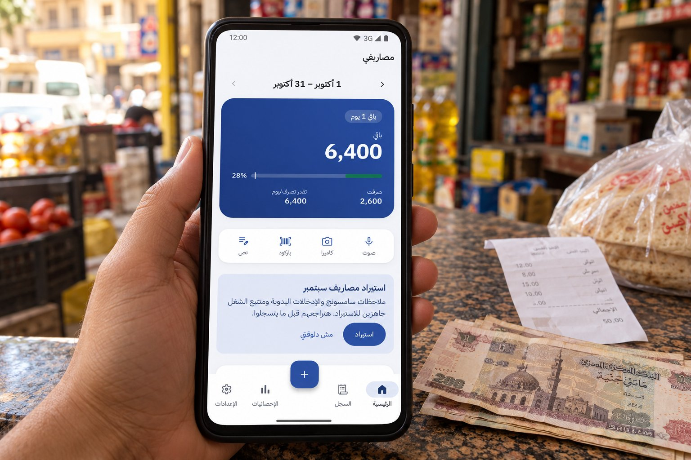

<sub>Concept image of the app on a phone. The screen shows a real screenshot from demo data.</sub>

## How it works

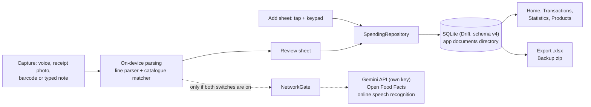

`NetworkGate` (`lib/data/net/network_gate.dart`) is the one way out to the network: it is the
only file allowed to use the HTTP client, a test checks that, and it refuses every request whose
switches are off.

## Screens

| Screen | What it does |
|---|---|
| الرئيسية (Home) | Salary period header, what is left and the safe amount per day, today's entries, a spending trend, top categories, upcoming bills, this month against the last |
| السجل (Transactions) | Every entry grouped by day, with search across names, notes, photo text and voice transcripts, and filter chips |
| الإحصائيات (Statistics) | A donut of the selected month by category and a history of every month with spending |
| الإعدادات (Settings) | Appearance, online features, recurring bills, import, export to .xlsx, full backup and restore |
| Add sheet | Category, subcategory and item strips with a keypad; products sold by the litre, kilo or gram open a quantity step |
| Capture | Voice note, photo of a receipt, barcode scan or a typed note, each parsed into lines and shown in the review sheet |
| امسح واعرف (scan and check) | Scan a barcode to see the last price paid and the catalogue price without logging anything |
| المنتجات (Products) | Edit a product's name, category, price, unit and barcode, with its price history |

| Home | Trend and categories | Add sheet | Review sheet |
|---|---|---|---|
|  | 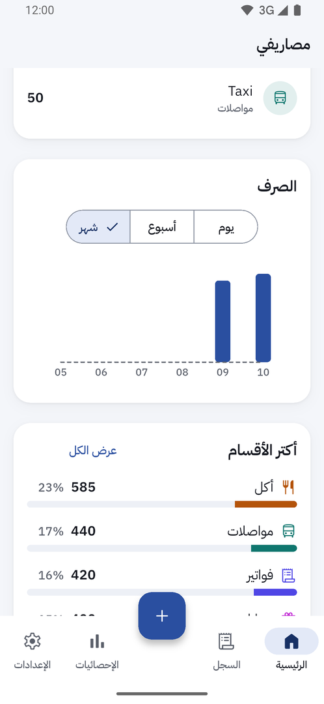 |  | 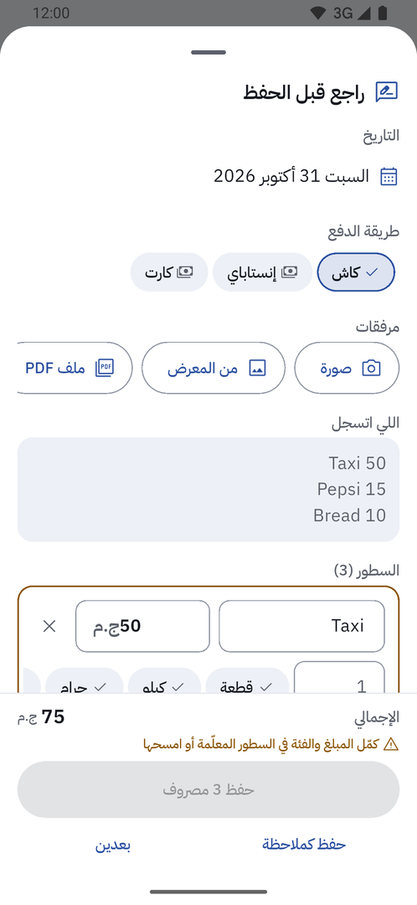 |

| Import review | Transactions | Statistics | Month history |
|---|---|---|---|
| 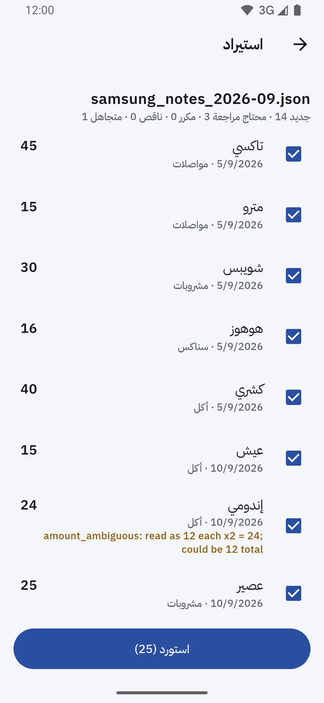 | 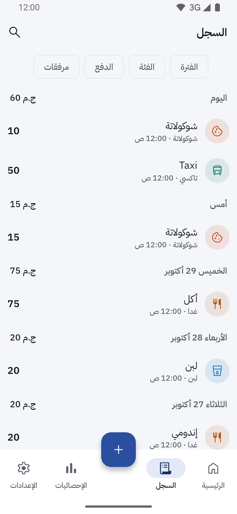 |  | 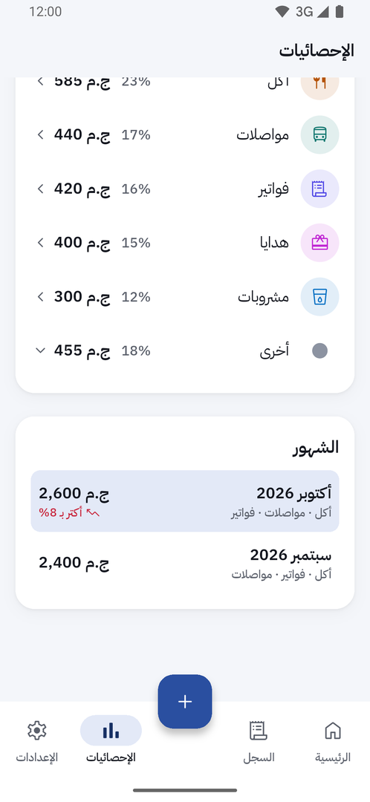 |

| Settings | Excel export | Recurring bills |
|---|---|---|
| 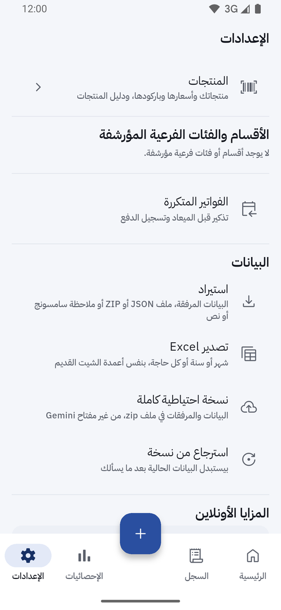 | 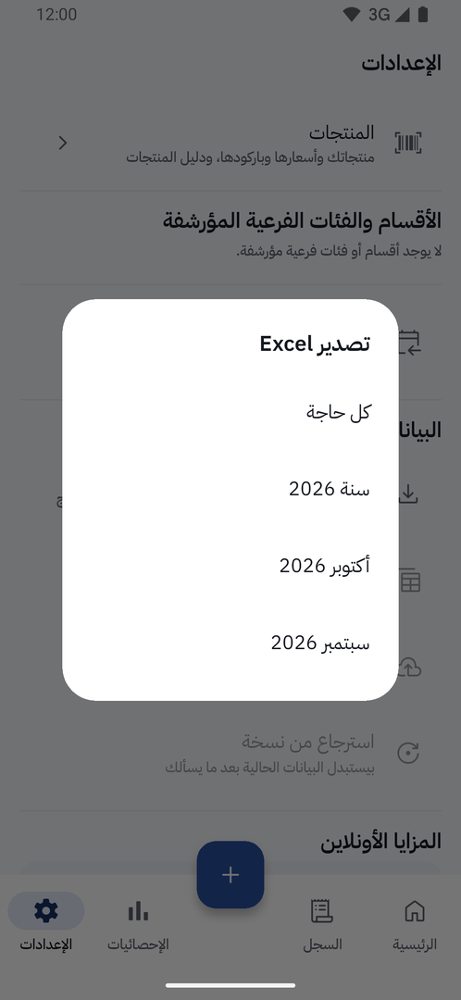 | 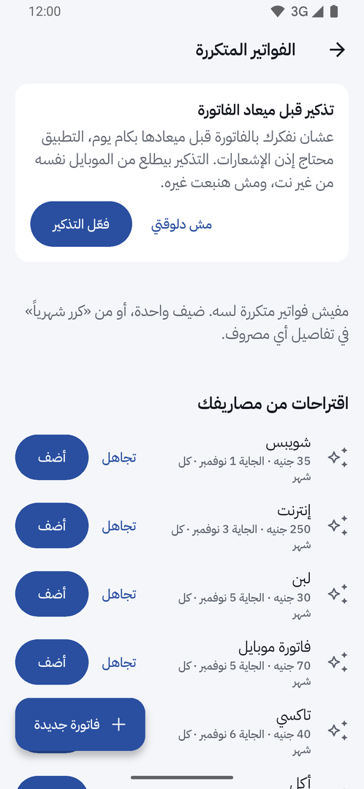 |

<sub>Screenshots from the emulator with the sample data. All names and amounts are made up.</sub>

## Quick start

**Just install it:** download [`spending-tracker-3.1.1-arm64.apk`](https://github.com/AbdelRahman-Madboly/spending-tracker/releases/latest/download/spending-tracker-3.1.1-arm64.apk) on an Android phone, open it and allow installing from this source. It starts empty and asks for the salary. A demo build with two months of made-up entries is on the [release page](https://github.com/AbdelRahman-Madboly/spending-tracker/releases/latest). To build it yourself:

Requires Flutter 3.44.4 (see `.fvmrc`), JDK 17 and the Android SDK.

```sh
git clone https://github.com/AbdelRahman-Madboly/spending-tracker.git && cd spending-tracker
flutter pub get
flutter analyze
flutter test
flutter build apk --debug                      # personal flavour, sample data
flutter build apk --release --flavor shared    # for anyone else
```

After changing `lib/data/db/tables.dart`, regenerate the Drift code with
`dart run build_runner build`.

## Builds

There are two flavours on one application id:

| Flavour | Ships with |
|---|---|
| `personal` (default) | Sample data: two months of made-up entries and salaries, two sample import packs and a sample InstaPay name, so every screen has something to show |
| `shared` | Every category, subcategory and generic item and the product catalogue, no entries. A short welcome asks for the salary |

All bundled data is fake. [`assets/catalog/SOURCES.md`](assets/catalog/SOURCES.md) describes the
sample product catalogue and its format.

The online features are optional and need the user's own API key. With no key, or with the online
switch off, everything runs on the phone.

## How data is stored

| What | Where |
|---|---|
| Entries, categories, products, salary periods, bills, settings | One SQLite database (Drift, schema v4) in the app's documents directory |
| Photos, voice notes, imported files | Folders under the same documents directory |
| Online API key | Android secure storage, never in the database, exports or backups |
| Backups | A zip of the database and the attachment folders, saved where the user picks |

Money is stored as whole piastres, never as a floating point number. Quantities are stored in
milli-units (1500 is 1.5 kilo). Deleted entries are soft deleted and left out of every total.
Before a schema migration the app copies the database file to `backups/` and checks the copy.

Nothing reaches the network unless the master online switch and the feature's own switch are both
on. Both are off by default. The online features are smarter parsing and photo reading through the
Google Gemini API (with the user's own key), product lookup by barcode on Open Food Facts, and
online speech recognition.

## What it does not do

- No accounts, sync or cloud storage. One phone holds the data; move it with a backup file.
- No bank or card connection. Entries are typed, spoken, scanned or imported.
- No iOS build. Only Android is configured and tested.
- The bundled product catalogue is a 20-product sample, not a real price list.

## Status

Version 3.1.0. In daily use by its author.

## Tests

Analyzer clean; the test suite covers money math, parsing, import, the database migrations from
v1 to v4 and every screen. CI (`.github/workflows/ci.yml`) runs analyze, the tests and a debug APK
build on every push, and keeps the debug APK as a build artifact.

```sh
flutter analyze
flutter test
```

## Repository layout

| Folder | Contents |
|---|---|
| `lib/core/` | Money, quantities, Arabic text, design system and shared widgets |
| `lib/domain/` | Models, parsing, import, statistics, bills and the repository interface |
| `lib/data/` | Drift database and repository, capture services, network gate, export and backup |
| `lib/features/` | One folder per screen or sheet |
| `assets/` | Fonts, icon, sample catalogue, seed data and sample import packs |
| `drift_schemas/` | Saved schema versions for migration tests |
| `test/` | Unit, widget, migration and RTL tests |

## Changes

[`CHANGELOG.md`](CHANGELOG.md) lists the versions. The commit history is the app's real
development history from September 2026 on. Personal records were taken out of every commit and
replaced with the sample data above, so older commits do not build with the data they were
written against.

## License

MIT, see [LICENSE](LICENSE).

## Author

Designed and built by **Abdel Rahman Mohamad EL-Sayed** ([@AbdelRahman-Madboly](https://github.com/AbdelRahman-Madboly)).
